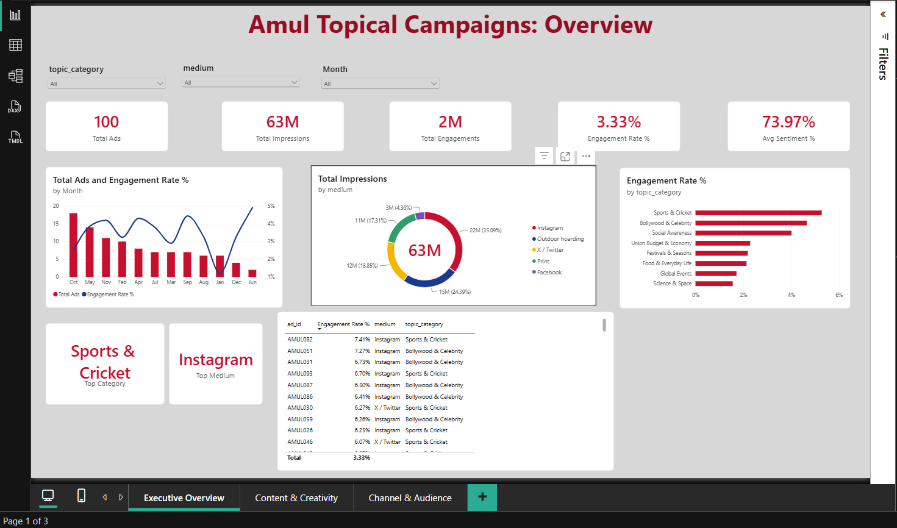
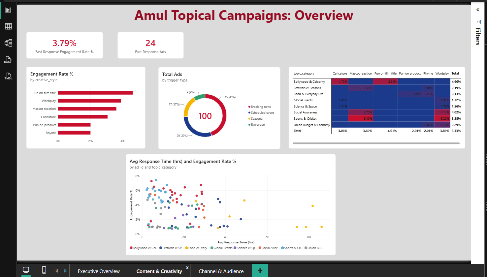
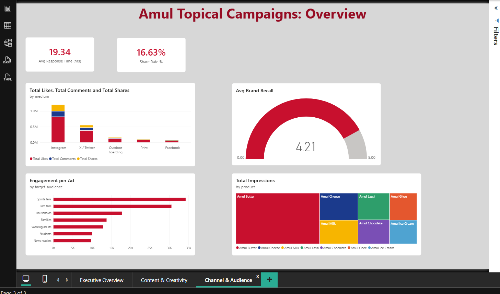

# Amul Topical Campaigns: Power BI Dashboard

Class project **Market Campaign Comparisons**: an analysis of Amul's topical advertising, where wordplay and humor react to current events while the Amul Girl and the "Utterly Butterly Delicious" identity stay consistent.

The repo has a dataset of 100 Amul ads and a 3-page interactive Power BI dashboard built on it.

**Download link (Google Drive): https://drive.google.com/file/d/1gMc3JBj2UnqM9_gIRdZxK054fqkleG1R/view?usp=sharing

## Dashboard preview

### Page 1: Executive Overview

### Page 2: Content & Creativity

### Page 3: Channel & Audience

## Repository contents

| File | Description |
|---|---|
| `PROJECT DASHBOARD.pbix` | Power BI report (3 pages, data model, date table and measures) |
| `amul_campaigns_100.csv` | Dataset: 100 Amul ads, 21 columns |
| `photos/` | Screenshots of the three dashboard pages |
| `README.md` | This file |

## How to open

1. Install **Power BI Desktop** (Windows).
2. Download `PROJECT DASHBOARD.pbix` and open it.
3. If the data does not load, go to **Home > Transform data > Data source settings > Change source**, and point it to `amul_campaigns_100.csv`. Then click **Close & Apply**.

## Dataset

100 ads released between 8 January and 23 December 2025.

| Column | Description |
|---|---|
| ad_id | Ad ID (AMUL001 to AMUL100) |
| release_date | Date the ad was released |
| topic_category | Sports & Cricket, Bollywood & Celebrity, Union Budget & Economy, Festivals & Seasons, Science & Space, Global Events, Social Awareness, Food & Everyday Life |
| product | Amul product featured (Butter, Milk, Cheese, Ice Cream, Lassi, Chocolate, Ghee) |
| trigger_type | Breaking news, Scheduled event, Seasonal, Evergreen |
| medium | Outdoor hoarding, Print, Instagram, X / Twitter, Facebook |
| creative_style | Wordplay, Pun on film title, Pun on product, Rhyme, Caricature, Mascot reaction |
| target_audience | Sports fans, Film fans, Working adults, Families, Students, News readers, Households |
| response_time_hrs | Hours between the event and the ad |
| impressions, likes, shares, comments, total_engagements | Reach and engagement counts |
| engagement_rate_pct | Engagements as a percentage of impressions |
| positive_sentiment_pct | Share of positive reactions |
| brand_recall_score | Recall rating from 1 to 5 |
| month_name, month_no | Month of release |
| mascot_present, tagline_present | Amul Girl and tagline present (always Yes) |

> **Data note:** this is an illustrative dataset. The categories and attributes follow how Amul's topical campaign works, but impressions, engagement, sentiment and recall values are **simulated**. Replace them with real data before presenting them as findings.

## Data model

- **Amul_Ads:** the dataset table.
- **Date:** calendar table for 2025 (Date, Month, Month No, Quarter), linked one-to-many to `Amul_Ads[release_date]`. `Month` is sorted by `Month No`.

### Measures

| Measure | Definition |
|---|---|
| Total Ads | Number of ads |
| Total Impressions | Sum of impressions |
| Total Likes / Shares / Comments | Sum of each column |
| Total Engagements | Likes + shares + comments |
| Engagement Rate % | Total Engagements / Total Impressions |
| Share Rate % | Total Shares / Total Engagements |
| Avg Sentiment % | Average positive sentiment |
| Avg Response Time (hrs) | Average hours from event to ad |
| Avg Brand Recall | Average recall score (0 to 5) |
| Engagement per Ad | Total Engagements / Total Ads |
| Fast Response Ads | Ads released within 8 hours of the event |
| Fast Response Engagement Rate % | Engagement rate of those fast-response ads |
| Top Category | Topic with the highest engagement rate |
| Top Medium | Medium with the highest engagement rate |

## Dashboard pages

| Page | What it shows |
|---|---|
| **Executive Overview** | KPI cards (ads, impressions, engagements, engagement rate, sentiment), ads and engagement rate by month, impressions by medium, engagement rate by topic, top ads table, slicers for topic, medium and month |
| **Content & Creativity** | Engagement rate by creative style, topic x style heatmap, ads by trigger type, response time vs engagement rate, fast-response cards |
| **Channel & Audience** | Likes, comments and shares by medium, engagement per ad by audience, impressions by product, average brand recall gauge, share rate and response time cards |

## Key findings

From the simulated data (all ads, no filters):

- **Scale:** 100 ads, about 63M impressions and 2M engagements, giving a 3.33% engagement rate and 73.97% positive sentiment.
- **Best topic:** Sports & Cricket has the highest engagement rate, followed by Bollywood & Celebrity and Social Awareness.
- **Best medium:** Instagram earns the most impressions (about 35%) and the highest engagement rate, followed by X / Twitter.
- **Best creative style:** puns on film titles lead, then wordplay and mascot reactions.
- **Speed matters:** the 24 ads released within 8 hours of an event have a 3.79% engagement rate, above the 3.33% overall.
- **Audience:** sports fans and film fans generate the most engagement per ad.
- **Product focus:** Amul Butter takes the largest share of impressions.
- **Brand recall:** averages 4.21 out of 5.

## Questions the dashboard answers

- Which topics (cricket, Bollywood, Budget, festivals) get the most engagement?
- Which medium performs best?
- Do faster responses to events earn more engagement?
- Which creative style works best?
- Which audiences engage most, and how does engagement change through the year?

## Tools

- Power BI Desktop (data model, DAX measures, visuals)
- CSV dataset

## Author
Rishabh Anand(FET-BDS-2024-28-006)
Suprit Mohanty(FET-BDS-2024-28-008)
Nandini Kumari Singh(FET-BDS-2024-28-020)
Om Nayak(FET-BDS-2024-28-024)
